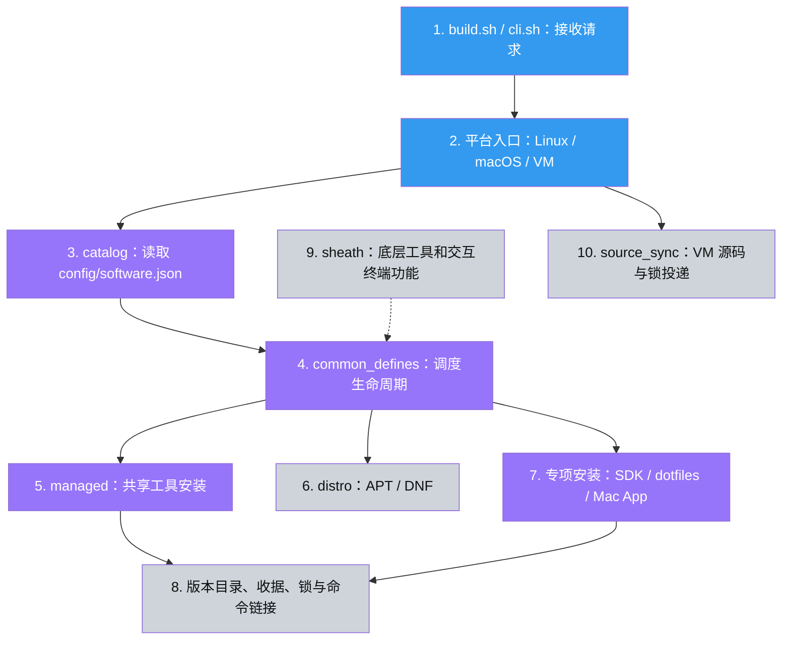

# 从零认识 dev-env-linux

这份文档面向还不熟悉 Shell、软件包管理器和虚拟机的读者。先读前六节，就能知道项目在做什么；后面介绍维护、恢复和代码阅读。

## 1. 它解决什么问题

换一台开发机器时，你通常要做三件事：安装工具、配置工具、调整终端环境。
如果都靠手工，容易忘记装过什么、版本不一致，也很难恢复之前的配置。

这个仓库把这些操作变成一套可检查、可重复运行的说明书和安装程序。
你告诉它“我要哪些工具”，它根据操作系统选择安装渠道，安装后记录版本及文件归属。
同时，它能部署 Git、SSH、Neovim、tmux 等配置，以及一套名为 sheath 的终端辅助功能。

它主要由 Bash 和 Python 编写。Bash 负责调用命令、串起流程；Python 负责软件清单、版本记录、文件校验和恢复等结构化处理。
`build.sh` 名字虽然叫 build，但项目本身不是需要编译后才能打开的桌面 App；执行它主要是在准备开发环境。
被安装的第三方工具可能需要编译，所以一次完整安装仍可能很久。

当前清单有 143 个软件条目，Linux 默认分组有 76 个。这不代表运行一次会安装全部 143 个，
也不代表所有条目在所有平台都可用。清单包含手动可选、受架构限制、已停用或等待来源信息的软件。

## 2. 先区分你的 Mac 和测试机

你的 Mac 是“宿主机”，是你每天使用、需要保护的电脑。
Orb 中的 Linux 虚拟机是“guest”，可以把它理解为电脑里另一台有自己磁盘、系统和用户目录的电脑。
本项目当前约定：**在 Mac 编辑源码，在隔离 guest 中执行安装和测试**。

```text
你的 Mac
  ├─ 当前 dev-env-linux：编辑、阅读、Git 提交
  └─ Orb 管理命令：把操作送进虚拟机
       └─ 隔离 Linux guest
            ├─ 一份源码副本
            ├─ guest 自己的 HOME、软件及配置
            └─ 安装、编译、回归验证
```

容器也是隔离运行的一种方式，但它与宿主或所在 VM 共享内核；Linux 容器不能充当真实 macOS。
Linux 中假装有 brew 的测试，只能检查程序分支和文件保护，不能证明 Mac GUI、签名和输入法授权真的可用。

当前 Ubuntu 验证机叫 `dev-env-verify-20261013`，guest 仓库路径是 `/home/sbrave/dev-env-linux`。
Fedora 和 CentOS 另有独立验证 VM。它们没有宿主共享目录。
执行 `orbctl run ...` 是让 Orb 在 guest 里面运行后面的命令，不是在 Mac 原生运行项目。

## 3. 目录地图：每部分负责什么

| 位置 | 小白可以怎么理解 | 什么时候看 |
| --- | --- | --- |
| `README.md` | 项目首页与常用入口 | 第一次打开项目 |
| `build.sh` | 总开关，先读参数再选择执行路线 | 想知道命令从哪里开始 |
| `scripts/cli.sh` | 参数检查员 | 想了解 --only 等选项 |
| `config/software.json` | 软件采购清单：选什么、从哪里拿、默认版本是什么 | 添加软件、调整分组或来源 |
| `scripts/catalog.py`、`catalog.sh` | 清单读取和校验员 | 清单报错、查询安装来源 |
| `scripts/setup_linux*.sh`、`setup_macos*.sh` | 按平台安排工作的负责人 | 排查某个平台的流程 |
| `scripts/distro/apt.sh`、`dnf.sh` | 不同 Linux 软件包管理器的适配器 | 原生包安装问题 |
| `scripts/common_defines.sh` | 调度台：前置步骤、安装、配置、缓存、超时和任务编排 | 通用流程问题 |
| `scripts/managed.sh`、`managed.py` | 共用安装器：版本目录、收据、命令入口、升级和回滚 | 共享后端工具问题 |
| `scripts/dotfiles.py` | 用户配置的备份、部署和中断恢复 | Git/SSH/Neovim 等配置问题 |
| `scripts/source_sync.py` | guest 源码投递检查员 | VM 上传冲突、版本锁传输问题 |
| `scripts/macos_inventory.py` | 只读查找已有 Mac App | 手动安装的软件是否会跳过 |
| `scripts/macos_bundle.py`、`macos_config.py` | Mac Qt 源码 App 和编辑器配置的专项处理 | 特殊 Mac 工具问题 |
| `scripts/rust_sdk.sh`、`verified_download.py` | SDK 私有安装及下载校验 | Rust/Go 安装问题 |
| `scripts/managed_gc.py` | 清理不再需要的受管旧版本 | 安装目录占用太大 |
| `scripts/export_lock.py` | 从实际安装记录生成版本锁 | 更新已经验证过的版本记录 |
| `scripts/native_bundle.py`、`export_native.py` | 原生包清单和离线包保存/恢复 | 需要断网恢复部分原生包 |
| `scripts/dockerfile_*` | Docker 镜像制作配方 | 调整容器基础依赖 |
| `config/` 中其他文件 | Git、SSH、Neovim、kitty、VS Code 等配置模板和源码补丁 | 调整工具默认配置 |
| `sheath/` | 安装后日常使用的 Shell 工具箱 | 终端别名、提示符、备份、目录切换等 |
| `tests/`、`scripts/check.sh` | 自动检查程序 | 每次修改后在 guest 验证 |
| `.github/workflows/` | 远程自动检查的工作流定义 | CI 与手动 Mac 验证 |
| `validation/` | 某次验证的结果与证据 | 判断“究竟验证到了什么” |
| `software.lock.json` | 工具已经验证过的精确版本、提交及部分依赖记录 | 阅读版本基线，不手改 |
| `archive/legacy/`、`.local/history/` | 忽略的历史目录和本机日志 | 通常不需要，不能当活动源码 |

根目录还有多份 Markdown 文档。`SOFTWARE_CATALOG.md` 讲清单维护，`INSTALLATION_SAFETY.md` 讲重复执行的影响，
`MACOS_TESTING.md` 讲真实 Mac 如何隔离验证，`FULL_VALIDATION.md` 等记录历史实装范围。
`AGENTS.md` 和 `CLAUDE.md` 是给开发助手的仓库约定，不是软件安装记录。

文件扩展名可以帮助你快速识别：`.sh` 是 Shell 脚本，`.py` 是 Python 程序，`.json` 是结构化数据，`.md` 是说明文档。
以点开头的文件一般会在普通文件列表中隐藏，例如 `.gitconfig` 和 `.bashrc`。

## 4. 一次安装怎么走完整个项目

假设在隔离 Linux guest 的仓库里执行：

```bash
bash build.sh --skip-system --only=ccat
```

它的含义是：“只处理 ccat，使用默认的 install 操作，跳过系统初始化。”
这仍可能为了安装 ccat 而准备必要依赖，`--skip-system` 不等于禁止一切写入。

流程如下：

1. `build.sh` 找到仓库，`cli.sh` 检查参数拼写和值。非法选项会在安装前报错。
2. 识别操作系统。Linux 进入 `setup_linux.sh`，Mac 进入 `setup_macos.sh`；Mac 的 `--with-linux` 则进入 VM/容器包装入口。
3. Linux 选择 APT 或 DNF 驱动，并确保能用 Python 读取软件清单。
4. 清单决定选中的 App、安装来源、版本及是否优先使用原生包。`--only` 会缩小应用队列。
5. 调度层运行该 App 的前置准备、安装和可选配置；失败会返回错误，不会被当作成功。
6. 对 ccat 这类共享后端工具，共用安装器确定版本，在用户私有目录安装，写收据，再创建命令入口。
7. 任务结束后输出结果；共享后端的下一次 install 会继续核对自身状态，不只看“以前是否成功过”。

下面是代码的推荐阅读顺序。蓝色先读，紫色随后读，灰色遇到具体问题再读；颜色不是风险评级。



## 5. 为什么有多种安装方式

不同软件的发布方式不一样：有的适合用操作系统仓库安装，有的通过语言包工具发布，有的只能编译源码。
项目把相同渠道的重复工作集中起来，但保留渠道之间真实存在的差异。

| 渠道 | 可以怎么理解 | 安装记录由谁掌握 |
| --- | --- | --- |
| APT / DNF | Ubuntu/Debian 或 Fedora/CentOS 的软件商店 | 操作系统包数据库 |
| Homebrew / brew | macOS 常用的软件包管理渠道 | Homebrew 自己的记录 |
| Go / Cargo / pip / npm | 各语言生态的分发渠道，用来获取工具 | 项目的共享安装器及依赖记录 |
| Git / source | 获取确切源码版本或编译成工具 | 项目记录的提交、版本目录和收据 |
| SDK | Go/Rust 的开发工具链，其他工具可能依赖它们 | 专项安装器的私有目录 |
| dotfiles | 配置文件，不是可执行软件本体 | 快照、收据与恢复清单 |
| Mac Qt App | 特定旧桌面工具的源码构建和 App 发布 | Mac 专项版本目录及收据 |

“共享安装器”不是把所有软件都装进系统目录。它通常把每个版本放在用户私有目录中，
再用一个符号链接把命令名指向当前版本，类似把快捷入口指向选中的程序。

例如输入 `ccat` 时，终端先按 PATH 查找命令，可能找到 `~/.local/bin/ccat`，
这个入口指向 `~/.local/share/dev-env-linux/app/managed/ccat/某版本/...` 中的实际程序。
升级可以调整指向；旧目录保留，就有机会回滚。原生包不能因此自动获得同样的回滚能力。

## 6. 清单、版本锁、收据、缓存分别是什么

这四者很容易混淆，但用途不同：

| 名称 | 类比 | 负责什么 |
| --- | --- | --- |
| `config/software.json` | 采购计划 | 软件来源、分组、原生包映射、请求/默认版本 |
| `software.lock.json` | 经核实的采购型号表 | 仓库保存的精确安装版本和相关依赖；当前有 65 条记录，不覆盖所有 143 个条目 |
| 本机安装收据 | 收货单 | 这台 guest 实际安装了什么、命令在哪里、文件归谁 |
| 仓库成功缓存 `.dev-env-linux` | 已办事项打勾 | 某条命令曾成功，不能证明软件现在还在，也不能用来恢复系统 |

共享后端 install 的版本选择通常是：声明的显式期望版本 → 本机版本锁 → 仓库版本锁 → 查询上游。
upgrade 没有显式期望版本时通常会查询新版本；如果清单固定了版本，upgrade 也遵守它。
Go/Rust SDK 有独立的默认版本和环境变量覆盖规则，不能把共享后端的选择顺序直接套到所有渠道。

本轮修复了 VM 漏传 `software.lock.json` 的问题；否则空白 VM 没有本机锁时，可能去上游取不同版本。
版本锁也不是整台机器的完整快照：系统依赖、原生仓库的历史包可用性以及部分上游构建环境仍会影响重建。

## 7. 安装后文件放在哪里

以下默认路径都指执行安装的 guest 用户，不是当前 Mac 用户：

| 路径或变量 | 内容 |
| --- | --- |
| `CLONE_PATH`：`~/.local/share/dev-env-linux/src` | 下载文件和保留的源码 |
| `APP_PATH`：`~/.local/share/dev-env-linux/app` | 共享工具、SDK、配置快照等状态 |
| `APP_PATH/managed/<App>/<版本>` | 共享工具的版本目录 |
| `APP_PATH/managed/<App>/current.json` | 当前安装收据 |
| 同目录的 `previous.json` / `lock.json` | 回滚候选和本机选定版本；不是所有操作都会创建 previous |
| `APP_PATH/dotfiles/` | 配置的原文件备份、当前收据和未完成事务记录 |
| `BIN_PATH`：`~/.local/bin` | 日常敲命令时使用的入口 |
| `CODE_PATH` / `GOPATH`：`~/code` | 开发目录或相关默认值 |
| Mac guest 的 `~/Applications` | Qt 专项安装器默认发布的 App 链接 |

这些变量可以覆盖默认位置。维护时必须区分“源码目录”和“安装状态目录”；删掉源码不是卸载，
删除成功缓存也不是恢复。共享工具卸载通常只移除受管理的命令入口，版本目录保留，方便回滚或检查。
要节省空间，使用有预览的 GC 工具，而不是随意删除整个 APP_PATH。

## 8. install、upgrade、uninstall、rollback 的区别

- `install`：把选中的工具准备好。共享后端尽量复用选定版本；dotfiles 已有收据时保留用户后续修改。
- `upgrade`：明确要求更新受管内容。它可能下载、编译或应用仓库的新配置；不是只读检查。
- `uninstall`：按对应渠道移除软件或受管入口。它不会保证系统依赖一起消失，也不会抹掉所有安装历史。
- `rollback`：适用的共享后端或 Qt App 切回已保存的前一版本；不是把整台系统回到某个时刻。

不是每个工具都支持四种操作。未知/缺失操作应报错；APT/DNF 与旧手动 hook 的能力不同。
重复 install 也不等于绝对不写磁盘：修复入口、更新收据、准备依赖仍可能发生。
系统初始化还可能升级系统包、配置 SSH 和时区；Mac 系统初始化会设置触控板和 Dock。
因此日常验证尽量选小范围，并明确使用 `--skip-system`。

Mac 手动安装的 App 会按声明的名称或 bundle ID 检测。找到完整的外部 App 时，跳过该 App 的安装和配置，不接管它。
检测范围不是整个磁盘，也不会把任意同名命令认作已安装软件；具体范围见 INSTALLATION_SAFETY.md。

## 9. dotfiles：配置文件为什么需要特别小心

dotfiles 是隐藏配置文件的统称，例如 `.gitconfig`、`.bashrc`、`.tmux.conf`。
用户会持续编辑它们，所以“每次用仓库文件盖过去”并不合适。

本轮后的正常过程是：

```text
获得这组配置的独占锁
  → 检查并恢复上次未完成的操作
  → 准备新配置和原文件备份
  → 写 pending.json 撤销清单
  → 替换每个目标，原文件暂存在同目录的 .old 旁路备份
  → 原子更新 current.json 收据
  → 清理本次临时文件
```

“独占锁”让两个安装进程排队，不同时改同一组配置；它不会阻止用户自己打开编辑器。
“原子更新”是先写好临时文件再替换，避免收据只写了一半就中断。
多个配置文件不能一次性同时替换，所以还要有 pending.json 记录过程。

如果进程被强杀，下次调用先恢复上一笔操作；也能在 guest 单独运行 `python3 scripts/dotfiles.py recover`。
如果收据已确认提交，则完成清理；未提交则恢复开始前的状态。
如果中断后用户又改了相关文件，恢复会报告冲突并保留文件，不擅自决定哪份更重要。
这时不要删 pending.json、快照或 `.dev-env-dotfiles-*` 旁路文件；它们是恢复依据。

重复 install 不会把用户后来编辑的配置换回模板，显式 upgrade 才应用仓库配置。
卸载时，用户改过的内容、权限和目录链接会被保留；`.bashrc` 中属于项目的启动行可单独去掉。
新收据会保存权限状态；旧收据没有记录过的权限变化无法事后推断，仍保留兼容的内容比较逻辑。
这里验证的是进程中断恢复，不承诺整机断电、坏盘或同一用户恶意并发篡改下的完整数据库级保证。

## 10. VM 中开发时，为什么现在会拒绝同步

`setup_linux_vm.sh` 会创建或复用指定的隔离 Ubuntu guest，在需要时先在 guest 内引导 Python，
然后把筛选后的源码及版本锁送进 guest。Mac 只打包文件和调用 Orb，接收程序在 guest 里执行。

guest 中 `.dev-env-source-manifest.json` 记录上次投递的源码内容摘要和权限。
下次同步前，会检查整批目标文件：

- 上次属于投递且没有被修改的文件，可以更新；上游不再提供的、未修改旧文件可以移除。
- guest 自己的额外笔记不在投递记录中，保留。
- 同名文件被修改、删掉或权限变了，且与新投递内容不一致，整批源码同步停止，先不改其他源码文件。
- 没有投递记录的旧目录，只能复用内容和权限完全相同的文件；不能覆盖不同的现有文件。

它不会自动合并 Git 冲突，也没有强制覆盖开关。遇到冲突，先把 guest 编辑保存回当前开发仓库或其他安全位置，
再明确处理冲突文件；不要删除清单来绕过保护。新投递增加的文件如果与用户同名文件内容或权限不同，也会被拦住。
完全相同的文件可以复用，并纳入后续投递记录；之后不要把它当作不受投递管理的私人文件。
中途终止的投递可用相同源码重试；只有 receiver 完整成功后才启动 guest 的 build.sh。
它不是整批源码一次原子替换，也不协调用户编辑器，因此不要一边同步一边手改同一批文件。

Docker 包装入口目前不同：同名容器存在会拒绝，不会自动复用，也不能按 VM 的规则推断其行为。

## 11. sheath 是什么，装完以后有什么用

安装器负责把环境准备好；sheath 则更多用于之后每天打开终端的体验。
`sheath/init.sh` 加载通用函数和环境；交互式终端才进一步加载别名和配置，避免别名干扰安装脚本。

可以把它分成四层：`constant.sh` 定义路径与颜色，`functions.sh` 提供函数，
`environments.sh` 设置 PATH 和提示符，`alias.sh`、`configuration.sh` 提供交互便利。
功能包括备份恢复、日志、批量执行、终端提示符和现代工具的快捷别名。
`scd` 使用 direnv 的授权环境；不是直接执行目录里任意 `.env`。终端别名仍可能改变你熟悉的命令体验，应阅读 sheath/README.md。

## 12. 维护时改哪里，哪些不要手改

改软件选择、版本或下载来源，先看 `config/software.json`；改 Git/SSH/终端默认配置，看对应模板；
特殊安装行为才改 scripts 中的程序。清单校验会拦截未知字段、错误类型和不安全路径。

`software.lock.json` 是从验证过的安装收据生成的，不是随手填写版本号的笔记。
需要更新时在 guest 使用 `scripts/export_lock.py`；生成后再检查差异。
Dockerfile 和源码补丁是生成源；容器里生成的文件、第三方 Makefile、编译产物应通过生成源修复。
`validation/` 保存某次运行的事实，不要为了“看起来通过”而手改旧日志。

配置模板也不代表里面所有 `${变量}` 都会自动替换。具体行为由对应消费者决定；
当前 dotfiles 部署主要复制模板，不能把未实现的变量替换当成功能使用。
不要把密码、令牌或个人密钥写进公共软件清单、模板或测试日志。

新增工具的低风险起步方式是：先为共享后端增加清单声明，不加入默认分组；
在 guest 显式 `--only` 验证后，再决定是否加入默认安装。

## 13. 怎么验证，哪些结果不能混为一谈

在 Mac 终端可以调用下面的 Orb 管理命令；实际检查发生在已有隔离 guest 中：

```bash
orbctl run -m dev-env-verify-20261013 -w /home/sbrave/dev-env-linux bash scripts/check.sh
```

`check.sh` 会校验清单、检查 Shell 语法、运行 Python 回归，再在存在 ShellCheck 时进行静态检查。
测试主要使用临时 HOME、目录和外部命令替身，不是在你的日常配置上做实验。

`tests/full_install.py` 是另一回事：它真的逐项安装默认软件，可能联网、编译、装系统依赖，
只能在准备好的一次性 guest/容器中运行。`tui_smoke.py` 还会模拟按键检查部分终端工具。
`sheath/functions_test.sh` 是历史日志演示，会故意退出失败；根目录被忽略的 `test.sh` 是本机环境配置，不是测试套件。

自动回归通过、Linux 真实实装通过、Mac 原生实测通过，是三种不同证据，不能互相替代。
远程 CI 工作流文件已经写好，也不等于它已经在远程成功执行。

## 14. 常见词汇速查

| 词 | 白话解释 |
| --- | --- |
| 仓库 / repo | 这套项目文件和 Git 历史 |
| Shell / Bash | 接收命令并运行脚本的程序 |
| CLI | 通过文字命令使用的入口 |
| guest / 宿主 | 虚拟机里的系统 / 外面的实际电脑 |
| profile / 分组 | 一组预先选好的软件 ID |
| backend / 安装后端 | 获取和安装软件的具体渠道 |
| hook / 钩子 | 在某个步骤调用的专项函数，如 install_linux_ccat |
| dotfiles | Git、Shell、编辑器等使用的隐藏配置文件 |
| PATH | 终端查找命令的一串目录 |
| 符号链接 / symlink | 指向实际文件或目录的路径入口 |
| receipt / 收据 | 安装器记录的实际安装状态及归属 |
| lockfile / 版本锁 | 固定已选择版本的数据；不同于“排队用的锁” |
| transaction lock / 事务锁 | 让同类操作一次只运行一个的协调机制 |
| journal / 恢复清单 | 未完成操作的撤销和提交判断依据 |
| idempotent / 幂等 | 重复操作得到一致的目标状态；不等于没有任何写入 |

## 15. 推荐阅读与第一步

按 `README.md → 本文 → config/software.json → build.sh → scripts/cli.sh → 平台入口 → 具体安装器` 阅读，
不必一开始就读完 managed.py 或所有 Shell 工具函数。

适合第一次练手的任务是：给现有清单条目补说明、调整一个不覆盖用户文件的配置模板、
或者为一个已知边界增加使用真实临时文件的回归测试。每次改小一点，在 guest 检查，保留清楚的提交。
